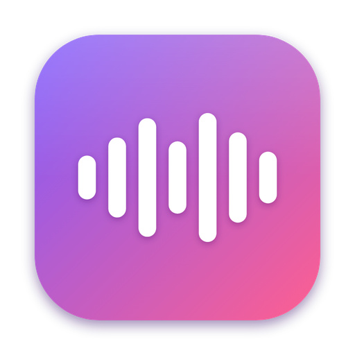
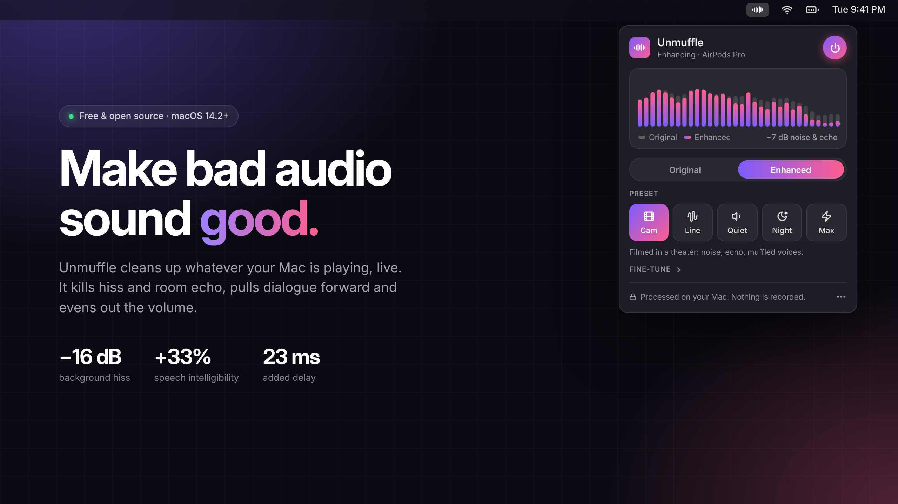
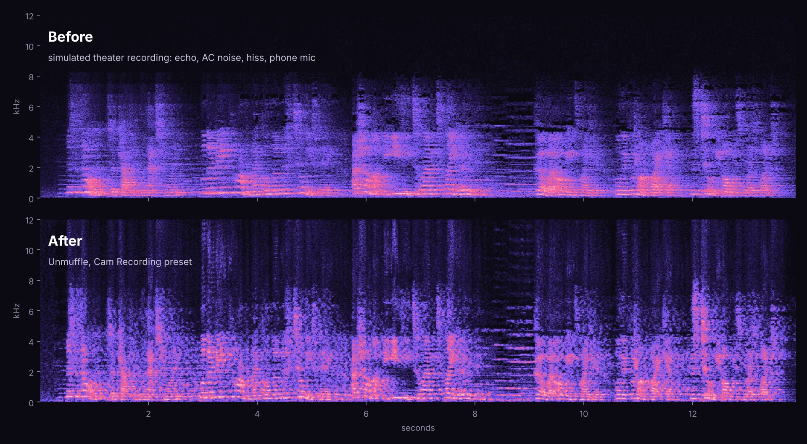
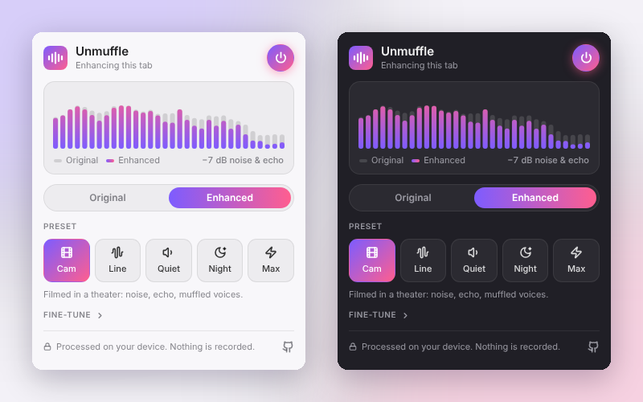
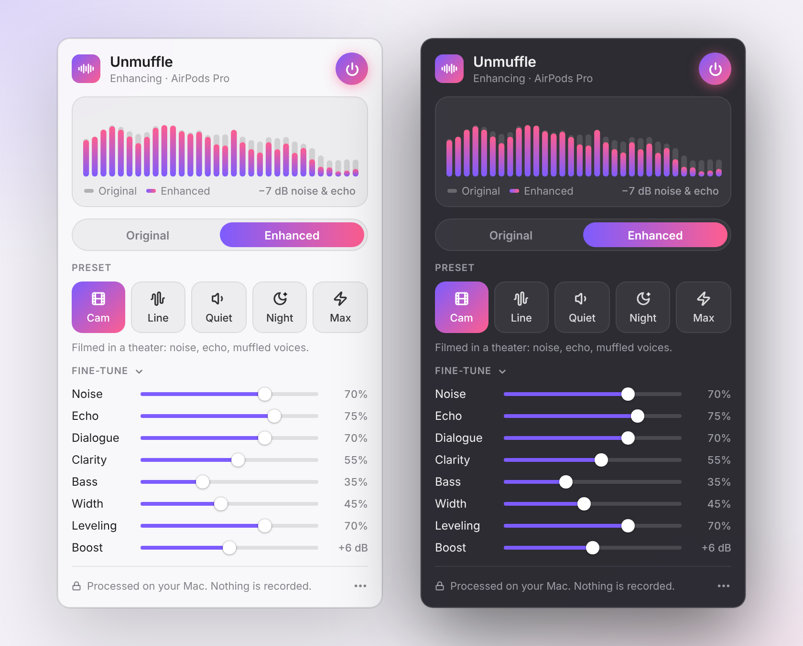

<p align="center">
  
</p>

<h1 align="center">Unmuffle</h1>

<p align="center">
  <b>Make bad audio sound good.</b><br>
  Real-time noise, echo and dialogue fix for everything your Mac plays.
</p>

<p align="center">
  <a href="https://github.com/ayaanrustagi/unmuffle/releases/latest/download/Unmuffle.zip"></a>
  <a href="#chrome-extension"></a>
</p>

<p align="center">
  <a href="https://github.com/ayaanrustagi/unmuffle/actions/workflows/ci.yml"></a>
  
  
  <a href="LICENSE"></a>
</p>

<p align="center">
  
</p>

Some videos sound terrible: filmed on a phone from the back of a theater, ripped from an
old stream, or recorded in a room that echoes. The dialogue is mush, there's a hiss
under everything, the room rings, and the explosions blow your ears off while the
whispers vanish.

**Unmuffle fixes that live.** On a Mac it cleans up everything you hear, from any app.
In Chrome it cleans up the tab you're watching. Hit the power button, pick a preset.
That's it.

## Hear the difference

<p align="center">
  
</p>

🎧 **[before.mp3](docs/demo/before.mp3)** vs **[after.mp3](docs/demo/after.mp3)**: a real voice
over a quiet string score, "recorded from the seats" of a virtual theater (1.1 s room
echo, air-conditioning rumble, preamp hiss, phone-mic tone, 48 kbps AAC), then run
through the Cam preset. Both files are loudness-matched, so what you hear is the cleanup,
not just the volume.

On that recording, speech intelligibility
([ESTOI](https://github.com/mpariente/pystoi), 0 to 1) goes from **0.16 to 0.22, a
33% gain**, averaged over three voices. Reproduce it with
[`docs/demo/score.py`](docs/demo/score.py).

## What it fixes

| Problem | What Unmuffle does |
| --- | --- |
| 🌫️ Hiss, hum, air conditioning, crowd murmur | Learns the background noise and subtracts it (about −16 dB) |
| 🏛️ Big-room echo | Predicts the room's reverb tail and removes it |
| 🗣️ Muffled, mumbly voices | Cuts the boomy low-mids, lifts the speech band, focuses the center |
| ✨ Dull, "underwater" sound | Regenerates the high end that cheap mics and low bitrates throw away |
| 🔈 Thin or mono sound | Adds back bass; turns mono into wide, mono-compatible stereo |
| 💥 Whispers vs. explosions | Lifts quiet lines without lifting the noise between them |
| 🔇 Too quiet overall | Up to +12 dB of boost behind a limiter, so it never distorts |

Flip **Original / Enhanced** any time to compare. The live spectrum shows what came in
(dim bars) and what you're hearing (bright bars); the gap is the noise being removed.

## Install

1. **[Download Unmuffle.zip](https://github.com/ayaanrustagi/unmuffle/releases/latest/download/Unmuffle.zip)**,
   unzip it and drag **Unmuffle.app** to Applications.
2. Open it. macOS will say it can't verify the developer, because it's a free app that
   isn't notarized through Apple's paid developer program. Go to **System Settings → Privacy &
   Security**, scroll down, and click **Open Anyway**. (Or run
   `xattr -dr com.apple.quarantine /Applications/Unmuffle.app` in Terminal.)
3. Click the waveform icon in the menu bar and hit the power button. When macOS asks to
   let Unmuffle record system audio, allow it. That's how it hears the audio it cleans
   up. Nothing is recorded, saved or sent anywhere; it all happens on your Mac.

Needs macOS 14.2 (Sonoma) or later, on Apple Silicon or Intel.

## Chrome extension

<p align="center">
  
</p>

Same engine, same presets, inside the browser (Chrome, Edge, Brave, Arc, any Chromium
browser 116+, on any OS). It captures the tab you're watching, cleans it up and plays
it back.

1. Download **[Unmuffle-Chrome.zip](https://github.com/ayaanrustagi/unmuffle/releases/latest/download/Unmuffle-Chrome.zip)** and unzip it.
2. Go to `chrome://extensions`, turn on **Developer mode**, click **Load unpacked** and
   pick the folder.
3. On a tab that's playing something, click the Unmuffle icon and hit the power button.

The JavaScript engine is a line-for-line port of the Swift one, and CI checks that both
produce the same audio. More in [extension/README.md](extension/README.md).

<details>
<summary><b>Build the Mac app yourself</b></summary>

```sh
git clone https://github.com/ayaanrustagi/unmuffle.git
cd unmuffle
./scripts/build-app.sh       # needs Xcode or the Command Line Tools
open build/Unmuffle.app
```

If you missed the permission prompt: **System Settings → Privacy & Security → Screen &
System Audio Recording → System Audio Recording Only**, enable Unmuffle, then switch it
off and on. Rebuilding can make macOS ask again, because local builds get a new signature
each time.
</details>

## Presets

| | Preset | For |
| --- | --- | --- |
| 🎬 | **Cam** | Filmed in a theater: noise, echo, muffled voices |
| 〰️ | **Line** | Decent source with some hiss and flat, thin sound |
| 🔉 | **Quiet** | Clean but too quiet, or dialogue buried in music |
| 🌙 | **Night** | One steady volume. Clear voices, tamed explosions |
| ⚡ | **Max** | Everything cranked, for the worst recordings |

Open **Fine-tune** to adjust each stage. Changes are instant and remembered.

<p align="center">
  
</p>

## Fix a downloaded file

The same engine ships as a command-line tool. With [ffmpeg](https://ffmpeg.org) you
can clean up a video's audio track and put it back:

```sh
swift build -c release --product unmuffle-cli

ffmpeg -i movie.mp4 -vn -ac 2 -ar 48000 audio.wav
.build/release/unmuffle-cli audio.wav fixed.wav --preset cam
ffmpeg -i movie.mp4 -i fixed.wav -map 0:v -map 1:a -c:v copy -c:a aac -b:a 192k movie-fixed.mp4
```

Every slider has a flag (`unmuffle-cli --help`). It runs about 50× faster than real time.

## How it works

```
 every app's audio ──► Core Audio process tap (originals muted)
                              │
                              ▼
   rumble filter → noise + echo removal (STFT) → dialogue EQ → exciter
     → mid/side width → leveler → boost → limiter
                              │
                              ▼
                  your speakers / headphones
```

- **System capture.** A Core Audio [process tap](https://developer.apple.com/documentation/coreaudio/catapdescription)
  (macOS 14.2+) grabs the mix of every app except Unmuffle and mutes the originals. A
  private aggregate device pairs the tap with your output device, so one callback reads
  the audio and writes the cleaned version. No virtual audio driver to install. If the
  app quits or crashes, macOS removes the tap and your audio comes straight back. Plug in
  headphones or connect AirPods and it follows.
- **Noise removal.** Short-time Fourier transform (1024 points, 75% overlap) with
  minimum-statistics noise tracking and a decision-directed Wiener gain. Two safeguards
  keep music intact: the noise floor comes from the quietest neighbouring frequencies
  (room noise is smooth across frequency, notes are peaky), and steady tones are left alone.
- **Echo removal.** The statistical late-reverb model of Lebart et al. predicts the room's
  tail from what played ~50 ms earlier and subtracts it.
- **The rest.** Biquad EQ, an envelope-normalized harmonic exciter, mid/side processing
  with complementary comb filters for mono-compatible width, a leveler whose expander
  follows the dialogue level, and a look-ahead brick-wall limiter.

All DSP is plain Swift with no dependencies. It uses about 2% of one CPU core and adds
about 23 ms of delay, well below what you'd notice as lip-sync drift.

## FAQ

**Does it work with YouTube, Netflix, VLC, Chrome, Safari…?**
Yes. It works on the Mac's audio output, so anything that plays sound gets cleaned up.

**Does it record anything?**
No. Audio is processed in memory and played straight back out. Nothing touches the disk
or the network.

**Can it remove people laughing or coughing in the recording?**
Not yet. They overlap the dialogue in time and frequency, and classic DSP can't pull
them apart. That needs a machine-learning model, which is on the roadmap.

**Will it hurt music?**
It's tuned not to. Tests check that held chords lose less than 1 dB to noise removal.
Echo removal does soften very long notes a little; turn Echo down for concerts.

**Windows? Linux?**
Use the Chrome extension: it runs anywhere Chrome does. The Mac app is macOS-only.

**Why does the extension only work on one tab at a time?**
Each enhanced tab is a separate audio capture, and one is what you need while watching
something. Turning it on in another tab moves it there.

## Roadmap

- [x] Chrome extension (same engine, in the browser)
- [ ] Chrome Web Store listing
- [ ] Per-app capture (only clean up the browser, leave notifications alone)
- [ ] ML dialogue isolation for laughs, coughs and people talking over the movie
- [ ] Auto-pick the preset by listening to the audio
- [ ] Keyboard shortcut for Original/Enhanced
- [ ] Signed and notarized builds, Homebrew cask

## Development

```
Sources/UnmuffleDSP/    the audio engine (cross-platform, tested)
Sources/Unmuffle/       the macOS menu bar app (SwiftUI + Core Audio taps)
Sources/unmuffle-cli/   the WAV command-line tool
Tests/UnmuffleDSPTests/ engine tests
extension/              the Chrome extension (JS port of the engine + tests)
docs/demo/              demo generator and intelligibility scoring
```

```sh
swift test                                # engine, on macOS or Linux
node --test "extension/test/*.test.js"    # extension engine
```

The tests check what matters by ear: hiss drops by more than 12 dB while speech-like
bursts and held chords come through within 1 dB; echo tails drop by more than 6 dB; the
leveler lifts quiet lines but not the pauses between them; nothing ever passes −1 dBFS;
neutral settings and bypass leave audio unchanged; every preset is stable at 44.1, 48
and 96 kHz.

PRs welcome, especially for the roadmap items.

## Credits

Process-tap know-how from [AudioCap](https://github.com/insidegui/AudioCap) and
[FineTune](https://github.com/ronitsingh10/FineTune). Demo audio and icon credits are in
[CREDITS.md](CREDITS.md).

## License

[MIT](LICENSE)
